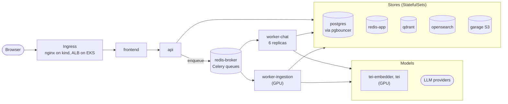
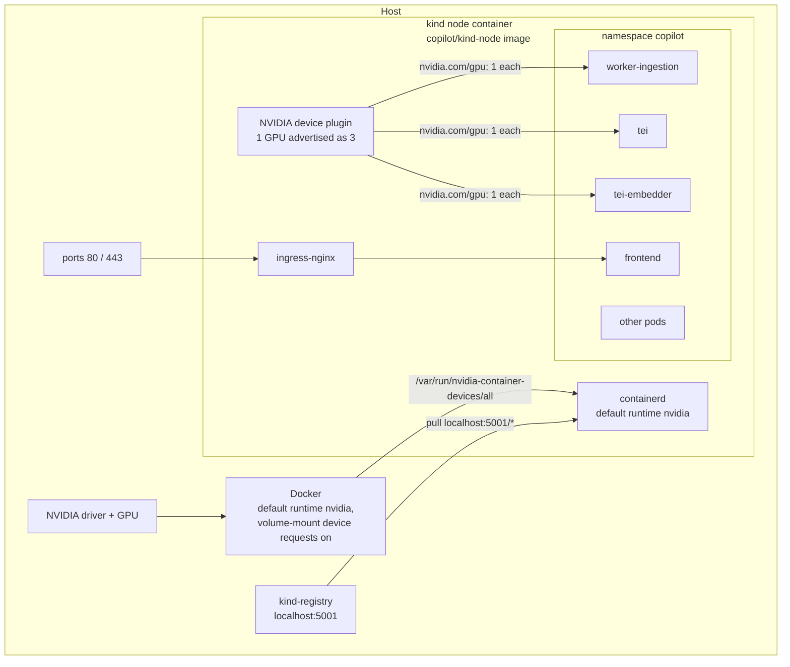
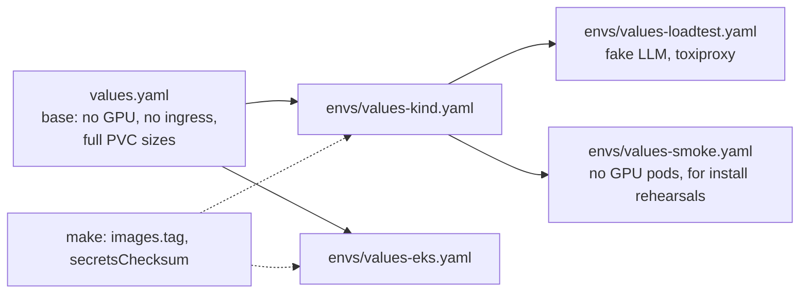
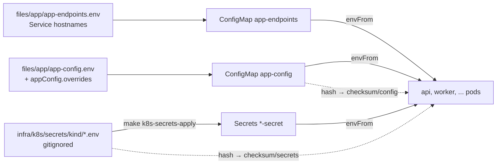
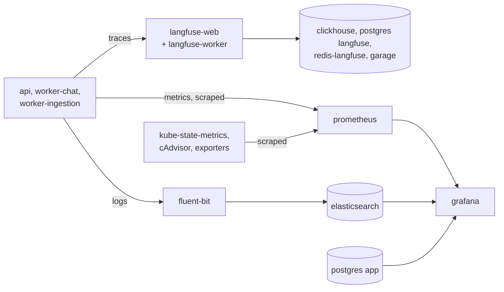

# Architecture

What the system is made of and where it runs. The stack is deployed from one Helm chart,
`infra/k8s/chart/`: today on a single-node kind cluster, next on EKS. This doc explains how the
pieces fit together and why. The commands live next to the chart:
[infra/k8s/README.md](../../infra/k8s/README.md) for operating the cluster and
[infra/k8s/chart/README.md](../../infra/k8s/chart/README.md) for changing the chart. If the
code and this doc disagree, the code wins, so fix the doc.

## Contents

1. [The short version](#1-the-short-version)
2. [Workloads](#2-workloads)
3. [The kind cluster](#3-the-kind-cluster)
4. [The Helm chart](#4-the-helm-chart)
5. [Observability in the cluster](#5-observability-in-the-cluster)
6. [Moving to EKS](#6-moving-to-eks)
7. [Crosscutting](#7-crosscutting)
8. [Local development without a cluster](#8-local-development-without-a-cluster)
9. [Design decisions](#9-design-decisions)
10. [Known limits](#10-known-limits)

---

## 1. The short version

The application is four workloads: a React frontend served by nginx, a FastAPI API, a Celery
chat worker and a Celery ingestion worker. Around them run the data stores, two GPU model
servers for embedding and reranking, and an observability stack, all in the namespace
`copilot` as one Helm release, also called `copilot`. How a chat request and an upload move
through them is in [chat_pipeline.md](chat_pipeline.md) and [ingestion.md](ingestion.md).

Which workload uses which store or model, and for what:

| | `api` | `worker-chat` | `worker-ingestion` |
|---|---|---|---|
| Postgres `app` (via pgbouncer) | Users, conversations, documents | Reads chunk text, writes messages and `llm_requests` | Documents, chunks |
| `redis-app` | Reads event streams for SSE, appends the history tail | Writes chat events, history cache | Writes progress events, ingestion leases |
| `redis-broker` | Enqueues tasks | Takes `chat` tasks | Takes `ingestion` tasks |
| Qdrant | Deletes a document's vectors | Dense search | Upserts vectors |
| OpenSearch | Deletes a document's chunks | Keyword search | Indexes chunks |
| Garage S3 | Stores uploads, serves the PDF viewer | | Reads the PDF, writes Docling JSON, picture crops, the chunk backup |
| `tei-embedder` | | Embeds queries | Embeds chunks |
| `tei` (reranker) | | Reranks search results | |
| LLM providers | | Router, tool model, answering model | Table summaries, picture descriptions |

The same chart renders for two clusters. The differences between them live in one values
file each:

| Cluster | Values | Status |
|---|---|---|
| kind, `kind-copilot`, one node with the host's GPU | `envs/values-kind.yaml` | Runs |
| EKS | `envs/values-eks.yaml` | Renders and passes the chart checks on every PR. Not deployed |

The problems this layout answers, and where each is handled:

| Problem | What handles it | Section |
|---|---|---|
| A local cluster usually has no GPU, but three workloads need one | A kind node image with the NVIDIA toolkit, and a device plugin that splits one GPU three ways | [3.1](#31-gpu-passthrough) |
| `kind load` re-imported every image on each rebuild, and a fixed tag could leave the old image running | A local registry and content-hashed image tags | [3.2](#32-the-local-registry) |
| kind and EKS drifting into two stacks | One chart. The differences live in values files, and `make helm-diff-envs` shows anything else | [4.1](#41-values-layering) |
| Secrets in git, or a changed secret that no pod picks up | Secrets are created outside the chart, and a checksum annotation rolls the pods that read them | [4.2](#42-config-and-secrets) |
| A deploy that cuts off a streaming answer or a half-parsed document | Rollout strategies and grace periods sized to the longest task | [4.4](#44-rollouts-and-shutdown) |
| An OOM kill or a stuck ingestion nobody notices | kube-state-metrics, cAdvisor and 14 alert rules | [5](#5-observability-in-the-cluster) |

---

## 2. Workloads

Memory is the request and the limit. Storage sizes are the base values, which EKS uses. kind
shrinks every StatefulSet claim to 2 GiB (see [3.4](#34-storage)). Images and versions are
pinned in `chart/values.yaml`. Templates are grouped by the folder named in each heading,
under `chart/templates/`.

**App** (`app/`)

| Workload | What it does | Object | Memory | GPU | Storage |
|---|---|---|---|---|---|
| `frontend` | nginx serving the built UI, proxying `/v1/` and `/api/` to `api` | Deployment | 64 Mi / 256 Mi | | |
| `api` | Auth, uploads, chat enqueue, SSE relay from Redis streams | Deployment | 512 Mi / 2 Gi | | |
| `worker-chat` | Celery queue `chat`: `process_chat` and the agent loop. 6 replicas × concurrency 4 = 24 chat requests at once | Deployment | 1.5 Gi / 3 Gi each | | |
| `worker-ingestion` | Celery queue `ingestion`: Docling parse, chunking, embedding, indexing | Deployment | 4 Gi / 12 Gi | 1 | `hf-model-cache`, 35 Gi, kept |
| `tei-embedder` | Embeddings, `BAAI/bge-m3`, for ingestion and queries | Deployment | 2 Gi / 12 Gi | 1 | `tei-embedder-data`, 10 Gi, kept |
| `tei` | Reranker, `BAAI/bge-reranker-v2-m3`, chat only | Deployment | 1 Gi / 8 Gi | 1 | `tei-data`, 10 Gi, kept |

The two workers share one image and differ only in their command. The ingestion worker gets
the GPU because Docling's layout and OCR models run on it. The chat worker runs no model on
the GPU itself. It calls the two TEI services.

**Data** (`data/`, `search/`, `storage/`)

| Workload | What it does | Object | Memory | Storage |
|---|---|---|---|---|
| `postgres` | The `app` database (users, conversations, messages, documents, chunk text, `llm_requests`) and Langfuse's `langfuse` database | StatefulSet | 512 Mi / 2 Gi | 5 Gi |
| `pgbouncer` | Connection pool. The app connects to `pgbouncer:6432`, never to Postgres directly | Deployment | 32 Mi / 128 Mi | |
| `redis-app` | Chat and ingestion event streams, the history cache, ingestion leases. 768 MB cap, `allkeys-lru` | StatefulSet | 256 Mi / 1 Gi | 2 Gi |
| `redis-broker` | Celery queues. No cap, because evicting a queued task would lose a user's question | StatefulSet | 128 Mi / 512 Mi | 1 Gi |
| `redis-langfuse` | Langfuse's ingestion queue. 192 MB cap, `noeviction` | StatefulSet | 64 Mi / 256 Mi | 1 Gi |
| `qdrant` | Dense vectors, keyed by chunk ID | StatefulSet | 1.5 Gi / 3 Gi | 10 Gi |
| `opensearch` | BM25 index, keyed by chunk ID. 1 GB heap | StatefulSet | 1.25 Gi / 2.5 Gi | 10 Gi |
| `garage` | S3-compatible store: PDFs, Docling JSON, picture crops, the chunk backup, Langfuse's blobs | StatefulSet | 256 Mi / 512 Mi | 1 Gi metadata, 10 Gi data |
| `opensearch-dashboards` | A UI for the BM25 index. kind only | Deployment | 256 Mi / 512 Mi | |

Langfuse has its own Redis because `redis-app` evicts keys when it fills up. That's right for
event streams and caches, and a full Redis is better than an OOM-killed one. But Langfuse
keeps its ingestion queue in Redis, and an evicted job loses a trace with no error.
`redis-langfuse` refuses writes when full instead.

**Observability** (`observability/`, `langfuse/`)

| Workload | What it does | Object | Memory | Storage |
|---|---|---|---|---|
| `prometheus` | Metrics and the alert rules, 30-day retention | Deployment | 256 Mi / 1 Gi | 5 Gi, kept |
| `grafana` | Dashboards | Deployment | 128 Mi / 768 Mi | 1 Gi, kept |
| `kube-state-metrics` | Pod and node state: restarts, OOM kills, phases | Deployment | 64 Mi / 256 Mi | |
| `fluent-bit` | Ships the app pods' logs to Elasticsearch | DaemonSet | 64 Mi / 256 Mi | |
| `elasticsearch` | App logs, behind the `copilot-logs` rollover alias. 512 MB heap | StatefulSet | 768 Mi / 1 Gi | 5 Gi |
| `dcgm-exporter` | GPU metrics. kind only | DaemonSet | 256 Mi / 512 Mi | |
| `langfuse-web`, `langfuse-worker` | Trace UI and trace ingestion | Deployment each | 512 Mi / 2 Gi, 512 Mi / 1 Gi | |
| `clickhouse` | Langfuse's trace store | StatefulSet | 1 Gi / 4 Gi | 20 Gi |

Postgres, PgBouncer and the three Redis instances also run an exporter sidecar each.

**Jobs** run as Helm hooks after every install and upgrade:

| Job | Does | Order |
|---|---|---|
| `garage-bootstrap` | Garage layout, buckets and the S3 key | First |
| `es-bootstrap` | Elasticsearch ILM policy, index template and the `copilot-logs` alias | First |
| `model-preload` | Downloads Docling's models into `hf-model-cache` | First |
| `seed-sample` | Ingests the demo corpus | After the other three |

Every job is idempotent, so running it again on the next deploy changes nothing.

On kind, the memory requests add up to about 24 GiB, 9 GiB of it the six chat workers. The
load-test values add `toxiproxy`, which injects latency in front of OpenSearch.

---

## 3. The kind cluster

kind runs a Kubernetes cluster inside a Docker container. Here it is the running deployment
and the rehearsal for EKS: the chart, probes, PVCs, Services, the ingress, Helm hooks and
rollbacks all behave as they would on a real cluster. It can't rehearse several nodes, cloud
storage, IAM, a cloud load balancer, autoscaling or real GPU isolation.

The cluster is one node, `copilot-control-plane`, in the kube context `kind-copilot`. Every
make target that reaches it passes `--kube-context`, because `kind create cluster` switches
the current context, and a deploy should never land on whatever context happens to be
current.

### 3.1 GPU passthrough

kind has no `--gpus` flag. The cluster config gets the GPU into the node container through the
NVIDIA toolkit's volume-mount protocol instead. A mount whose destination is
`/var/run/nvidia-container-devices/all` reads as a request for every GPU. For that to work,
Docker's default runtime has to be `nvidia`, and the host toolkit has to accept device
requests made as volume mounts. Going through the toolkit is what injects the driver
libraries. Without them the device plugin dies with
`Failed to initialize NVML: ERROR_LIBRARY_NOT_FOUND`.

Inside the node, a custom image (`infra/k8s/node-image/Dockerfile`) adds the NVIDIA
Container Toolkit to `kindest/node` and makes it containerd's default runtime. It pins the
toolkit version, because a toolkit mismatch between host and node is the most common way the
passthrough breaks. It also bakes in two settings, which the host needs too:

- `accept-nvidia-visible-devices-as-volume-mounts=true`, the grant path the device plugin
  uses.
- `accept-nvidia-visible-devices-envvar-when-unprivileged=false`. With it on, any pod could
  set `NVIDIA_VISIBLE_DEVICES` and take the GPU without asking the scheduler.

`make k8s-gpu-preflight` checks the host side of all this before a cluster is created and
prints the fix for each failure. Without it, a missing setting shows up as a pod stuck in
`Pending` an hour later.

NVIDIA's device plugin runs as its own Helm release in `kube-system`, from
`infra/k8s/addons/nvidia-device-plugin-kind.yaml`. It time-slices the GPU into three units,
one per GPU consumer, so `worker-ingestion`, `tei` and `tei-embedder` each request
`nvidia.com/gpu: 1`. Time-slicing shares compute but not memory, so the unit count has to
stay equal to the number of consumers. The node also carries the label
`nvidia.com/gpu.present=true`, set in the cluster config because NVIDIA's feature discovery,
which would normally set it, doesn't run here. The GPU pods select on that label.

### 3.2 The local registry

`kind-registry` is a `registry:3` container on `localhost:5001`, joined to the `kind` Docker
network. The node image tells containerd that `localhost:5001/*` lives at
`kind-registry:5000`, so the same image name works from the host (`docker push`) and from
the node (pull).

It replaced `kind load docker-image`, which copied the whole image into the node on every
rebuild. With a fixed `:dev` tag and `imagePullPolicy: IfNotPresent`, the node also kept
running the old image until someone remembered to load the new one. Now each image is tagged
with the commit plus a hash of uncommitted changes, so every saved edit is a new tag, a push
sends only the changed layers, and `IfNotPresent` is always right. EKS will pull from ECR the
same way. `make k8s-prune` keeps the newest three tags per image, plus any tag a pod still
uses, in the registry, on the node and on the host. A rollback works only while its tag is
still there.

### 3.3 Ingress and access

The cluster config maps the node's ports 80 and 443 to the host and labels the node
`ingress-ready=true`, which is what kind's ingress-nginx manifest expects. The ingress sends
every path to the `frontend` Service, and the frontend's nginx (`src/ui/nginx.k8s.conf`)
proxies `/v1/` and `/api/` to `api`. The ingress annotations turn off proxy buffering, so SSE
events arrive as they're written, and set 300-second timeouts and a 200 MB body limit for
uploads. The app is on `http://localhost`.

Nothing else has an ingress. Grafana (`3000`), Langfuse (`3000`, which expects to be browsed
at `http://localhost:3003`) and Prometheus (`9090`) are reached with `kubectl port-forward`.

### 3.4 Storage

kind's default `standard` class is the local-path provisioner. It creates a directory on the
node for each claim, binds it when the first pod using it is scheduled
(`WaitForFirstConsumer`), and sets the reclaim policy to `Delete`, so a deleted PVC deletes
its data. The cluster this was built on has every PV patched to `Retain` by hand, and nothing
in the repo does that. On a fresh cluster, deleting the namespace deletes the data.

Two kinds of claims hold data:

- **StatefulSet claims** from `volumeClaimTemplates`, for every store in the Data table and
  ClickHouse and Elasticsearch. Helm never deletes these.
- **Standalone PVCs** for the model cache, the two TEI caches, Prometheus and Grafana. They
  carry `helm.sh/resource-policy: keep`, so `helm uninstall` leaves them.

`envs/values-kind.yaml` sets the StatefulSet claims to 2 GiB. A `volumeClaimTemplate` can't
be changed on a live StatefulSet, so those sizes match what the cluster was created with.

The cluster config also bind-mounts two host directories, `infra/k8s/loadtest/results` and
`infra/k8s/loadtest/fixtures`, into the node for the load-test chart's PVs. Mounts are fixed
when the cluster is created, so a cluster older than a mount doesn't have it.

### 3.5 What `make k8s-up` builds

Once per machine, before the first cluster: `make k8s-node-image`, and the host GPU setup
that `make k8s-gpu-preflight` checks. Then `make k8s-up` runs, in order:

1. `k8s-gpu-preflight`.
2. `kind create cluster` from `infra/k8s/kind-cluster.yaml`.
3. `k8s-registry`: starts `kind-registry` if it isn't running and joins it to the `kind`
   network.
4. `k8s-gpu-plugin`: installs the device plugin and waits until the node reports
   allocatable `nvidia.com/gpu`.
5. `k8s-ingress-nginx`: applies kind's ingress-nginx manifest and waits for the controller.

None of these belong to the app release. They survive every deploy and only need running
again after `make k8s-down`. The app goes on with `make k8s-secrets` and `make k8s-deploy`,
which builds the three images, pushes them, applies the Secrets, runs
`helm upgrade --install --wait` and prunes old tags.

---

## 4. The Helm chart

One release, `copilot`, in the namespace `copilot`. The chart refuses to render into any other
namespace, and Helm doesn't manage the namespace itself, so no Helm command can delete it.

### 4.1 Values layering

`values.yaml` alone renders a stack that schedules on a cluster without GPUs. Each env file
sets only the seams: image registry, storage class and sizes, GPU node selection and
tolerations, ingress class and annotations, the sysctl init container, and the two dev-only
components. The full list, and the rule that `make helm-diff-envs` may show nothing else, are
in [the chart README](../../infra/k8s/chart/README.md#environments). `values-loadtest.yaml`
and `values-smoke.yaml` only ever layer on kind. `values.schema.json` rejects unknown keys in
the seam objects, so a typo like `gpu.enable` fails lint instead of doing nothing.

Every deploy passes all its values files again. `--reuse-values` would carry the previous
release's values forward, a load test's fake-LLM switch included.

### 4.2 Config and secrets

The app reads its settings from environment variables, and the chart builds them from three
sources:

- `files/app/app-config.env` holds the app's tuning settings and becomes the `app-config`
  ConfigMap. `appConfig.overrides` in a values file layers single keys on top. New app
  settings go in this file.
- `files/app/app-endpoints.env` holds the in-cluster hostnames and ports (`pgbouncer:6432`,
  `redis-app:6379`, `qdrant:6333`, ...) and becomes `app-endpoints`.
- Secrets never pass through the chart. Each lives in a gitignored env file under
  `infra/k8s/secrets/kind/`, one per Secret. `make k8s-secrets` generates any missing file,
  and `make k8s-secrets-apply` creates the `<name>-secret` objects with server-side apply.
  The chart only names them.

ConfigMaps and Secrets keep fixed names, so a change to one wouldn't restart anything by
itself. Each pod template carries `checksum/config`, a hash of the rendered ConfigMaps, and
`checksum/secrets`, a hash of the secret env files that make computes. A changed value changes
the hash, and the pods that read it roll. Rotating a secret has two catches, both in
[infra/k8s/README.md](../../infra/k8s/README.md#secrets).

### 4.3 Startup order and hooks

A pod that needs another service waits for it in `wait-for-<service>` init containers, which
run `pg_isready`, `redis-cli`, `curl` or `nc` until the dependency answers. Readiness probes
then gate traffic: `api` checks `/readyz` (Redis reachable, below the stream cap), the
workers answer a Celery ping, and the TEI pods check `/health` with a long failure budget,
because a cold start downloads the model first.

The four Jobs in [section 2](#2-workloads) are `post-install,post-upgrade` hooks. `seed-sample`
has weight 1 and the others weight 0, so the demo corpus is ingested only once the bucket and
the models exist. Under `--wait`, hooks run after every Deployment is ready, so nothing in the
release can wait on a hook: a fresh install would deadlock. Grafana's logs panels show errors
for the few seconds before `es-bootstrap` creates the log alias. `model-preload` downloads
several GB on a new cluster's first deploy, so that deploy needs `HELM_TIMEOUT=60m`. Later
deploys find the models cached.

### 4.4 Rollouts and shutdown

A rollout must not cut off a streaming answer or a document in the middle of parsing. Each
grace period is sized to the longest piece of work the pod can hold:

| Workload | Strategy | Grace period | Why |
|---|---|---|---|
| `api` | Rolling, `maxUnavailable: 0` | 240 s, after a 5 s `preStop` sleep | An SSE stream stays open for its whole agent run, up to about 230 s. The sleep lets the endpoint removal reach the ingress before SIGTERM |
| `worker-chat` | Rolling, `maxUnavailable: 0`, `maxSurge: 2` | 510 s | Above the chat task's 450 s hard limit, so a warm shutdown can finish the longest task. Surge keeps the queue served while old pods drain |
| `worker-ingestion` | `Recreate` | 2,800 s | Above ingestion's 2,700 s hard limit. `Recreate`, because the model cache is `ReadWriteOnce` and a second pod couldn't mount it |
| `tei`, `tei-embedder` | `Recreate` | Default | `ReadWriteOnce` model cache |

A rollback (`helm rollback`) restores the manifests and images of an earlier revision, and
doesn't re-run the hooks.

---

## 5. Observability in the cluster

**Metrics.** Prometheus discovers pods through the Kubernetes API and scrapes the ones
annotated `prometheus.io/scrape`: the API, both workers, the exporter sidecars and
`dcgm-exporter`. A relabel sets `job` to the pod's `app.kubernetes.io/name` label, which is
`api`, `chat_worker` and `ingestion_worker` for the app pods. Those are the job names the
dashboards query. Note that the worker pods' label differs from their Deployment names
(`worker-chat`, `worker-ingestion`), so a label selector has to use `chat_worker` and
`ingestion_worker`. Two more jobs cover what no pod reports about itself. kube-state-metrics gives restart counts, termination reasons (the
OOM-kill signal) and pod phases. The kubelet's cAdvisor, reached through the API server,
gives each container's memory and CPU use. kube-state-metrics has its own job because the
pod job would overwrite the `pod` label on every series it exports.

**Alerts.** `chart/files/observability/alert-rules.yml` holds 14 rules:

| Group | Fires on |
|---|---|
| Container resources | An OOM kill, memory near the limit, CPU throttling, restarts, a pod not ready |
| Node resources | Node memory pressure, an unhealthy node condition |
| Ingestion worker memory | A worker child starting above its memory threshold, recycling too often |
| Ingestion recovery | Documents reaped after a lost lease, recovery not converging |
| Agent latency | Agent runs cut off by the deadline, slow report turns |
| Scrape health | A scrape target down |

There is no Alertmanager. Firing rules show up as `ALERTS` series in Prometheus and Grafana,
and notify nobody.

**Dashboards.** Grafana reads Prometheus, Elasticsearch and, for four of its dashboards, the
`app` database. Seven dashboards ship with the chart. Five are identical to the Compose
copies (`make lint` checks this). `worker-health` is a chart variant that leaves saturation to
`resources`, and `resources` exists only here, since it reads cAdvisor and
kube-state-metrics.

**Logs.** The `fluent-bit` DaemonSet tails the node's container log files for the `api`,
`worker-chat` and `worker-ingestion` pods only, and writes them to Elasticsearch behind the
`copilot-logs` alias, which `es-bootstrap` creates with an ILM rollover policy.

**Traces.** The app sends traces to `langfuse-web`. Langfuse queues them in `redis-langfuse`,
`langfuse-worker` writes them to ClickHouse, and both keep their metadata in Postgres' own
`langfuse` database and blobs in Garage.

---

## 6. Moving to EKS

Nothing runs on EKS yet. `envs/values-eks.yaml` renders, and `make helm-check` lints it and
validates the render against the Kubernetes 1.36 schemas on every PR. Its ECR account and
region are placeholders.

Already in `values-eks.yaml`:

| Seam | kind | EKS |
|---|---|---|
| Images | `localhost:5001` | ECR |
| Storage | `standard`, 2 GiB StatefulSet claims | `gp3`, the base sizes in [section 2](#2-workloads) |
| GPU | Time-sliced, no taint | GPU nodes tainted, pods tolerate it |
| Ingress | `nginx` | `alb`, internet-facing, IP targets, 300 s idle timeout for SSE |
| `vm.max_map_count` for OpenSearch and Elasticsearch | Privileged init container | Set by the node bootstrap |
| `dcgm-exporter`, `opensearch-dashboards` | On | Off |

Open decisions:

- **Postgres:** keep the StatefulSet, or move to RDS. RDS brings backups and failover, and
  needs the `app` and `langfuse` databases and roles created outside `initdb`.
- **Object storage:** keep Garage, or use S3. S3 removes a StatefulSet and the
  `garage-bootstrap` hook, and the app already speaks S3 through `AWS_ENDPOINT_URL`.
- **Credentials:** IRSA, so pods get AWS access from their service account instead of keys
  in a Secret.
- **Langfuse:** `langfuseWeb.nextauthUrl` has to be the public URL, and Langfuse needs an
  ingress or a private way in.
- **OpenSearch security:** the chart sets `DISABLE_SECURITY_PLUGIN`. Fine on a single-user
  node, not on a shared cluster.
- **GPU node groups:** instance type, how many, and whether to keep time-slicing or give each
  GPU consumer its own GPU. The NVIDIA GPU Operator would replace the device plugin add-on
  and `dcgm-exporter`.
- **Node sizing:** the memory requests add up to about 24 GiB on kind, and the base storage
  sizes to about 126 GiB.
- **Alerts:** an Alertmanager and somewhere to route to.

### Lessons from adopting a live stack

Helm took over the kind stack, which Kustomize had built, with `--take-ownership
--force-conflicts`, after a fresh-install rehearsal on a throwaway cluster with
`values-smoke.yaml`. Every PVC kept its UID. The old Kustomize tree is in
`git log -- infra/k8s/base`. What applies the next time Helm adopts live objects:

- **Drop the old field manager after adopting.** Where Helm applied the value that was already
  live, the field stayed co-owned with `kubectl-client-side-apply`, so the first upgrade that
  changed it (the image tag) failed with a conflict. Removing that manager's `managedFields`
  entries, and its `last-applied-configuration` annotation, from the adopted objects made
  Helm the sole owner. That is a metadata patch, and no pod restarts.
- **Diff the live state on the server, as Helm.**
  `helm get manifest copilot -n copilot | kubectl diff --server-side --field-manager=helm --force-conflicts -f -`
  shows only Helm's own `meta.helm.sh/*` annotations, which the manifest leaves out. A plain
  `kubectl diff` compares against the old `last-applied-configuration` instead.
- **`--wait` also waits for every PVC to bind.** With a `WaitForFirstConsumer` class (kind's
  `standard`, EKS `gp3`), a standalone PVC binds only once a pod uses it. On a cluster where a
  PVC has no pod, such as the smoke cluster's TEI and model-cache claims, the install times
  out unless a throwaway pod mounts them first.
- **Adoption never deletes a field the chart leaves out.** Remove such fields from the live
  objects first, so they already match the chart.

---

## 7. Crosscutting

**Timeouts nest.** From outside in: Celery's broker visibility timeout (3,600 s), the chat
task's hard and soft limits (450 s, 360 s), the agent run deadline (180 s), one tool-model
call (120 s). Each inner one has to fire before the outer one, or the outer one kills work
that was about to finish. The pod grace periods in [4.4](#44-rollouts-and-shutdown) sit above
the task limits for the same reason. The full chain is in
[chat_pipeline.md](chat_pipeline.md#61-the-timeout-hierarchy), and ingestion's limits are in
[ingestion.md](ingestion.md#4-failure-and-recovery).

**Tasks survive a dead pod.** Celery runs with `task_acks_late`, `task_reject_on_worker_lost`
and a prefetch of 1, so a task whose pod dies goes back on the queue. Redelivery is capped per
task (`CHAT_MAX_ATTEMPTS`, `INGEST_MAX_ATTEMPTS`), so a task that reliably kills its pod
eventually fails instead of looping.

**Retrieval fails open.** If Qdrant, OpenSearch or the reranker is down, a search returns
what the others found, and the answer carries a degraded-retrieval badge. Only when every
backend fails does the answer say search is unavailable
([chat_pipeline.md](chat_pipeline.md#44-failing-open)).

**Prompt-injection scans run in three places:** on the user's message and prior questions,
on every excerpt before a model reads it, and on text the tool model writes into findings
([chat_pipeline.md](chat_pipeline.md#33-scan-user-input)).

**Auth.** The API issues JWTs signed with a shared secret (`HS256` by default, from
`JWT_SECRET`). Every route requires one except register, login, token refresh, the model
list and the health check. Only the frontend is behind the ingress, and its nginx forwards
only `/v1/` and `/api/`, so the API's `/metrics` stays inside the cluster. Every other
workload is a ClusterIP Service.

---

## 8. Local development without a cluster

`infra/docker/docker-compose.yml` runs the same services without Kubernetes, for working on
the code with hot reload: the infrastructure in containers, and the API, workers and Vite dev
server on the host (`make dev`). It can also run the app in containers. The steps are in
[README.md "Getting started"](../../README.md#getting-started). It isn't the deployment, and
it differs from the cluster in ways that matter when something works in one and not the
other:

- **One `.env` file** holds every setting and secret, and every `docker compose` command needs
  `--env-file ../../.env`.
- **The GPU** goes to `tei`, `tei-embedder` and `worker-ingestion` through CDI
  (`nvidia.com/gpu=all`), shared with no device plugin. The older `driver: nvidia` form does
  nothing for an unprivileged container, with no error. `docker-compose-pc.yml` is a full copy
  for a Blackwell GPU, with TEI's `120-1.9` image, and drifts from the main file.
- **No memory caps on Redis**, so Langfuse shares `redis-app`.
- **One chat worker container**, not six.
- **Logs** go through Docker's `fluentd` log driver to `127.0.0.1:24224`, so
  `docker compose logs` shows nothing for the app containers. With the app on the host,
  Prometheus scrapes nothing, because it targets container hostnames.
- **No alert rules**, and no kube-state-metrics or cAdvisor.

Helm reads only files inside the chart, so `chart/files/` holds copies of the files both
stacks use: the initdb and PgBouncer scripts, es-bootstrap and five Grafana dashboards.
`make k8s-sync-*` refreshes them from the Compose side, and `make lint` fails when one
drifts.

---

## 9. Design decisions

**One chart for kind and EKS.** Environment differences live in values files, and
`make helm-diff-envs` renders both and shows what differs. A difference outside the listed
seams means environment logic leaked into a template.

**The chart never renders a Secret.** A Secret in a values file ends up in git or in Helm's
release history. Creating them from gitignored files and referencing them by name keeps them
in one place, and the checksum annotation still rolls pods on a change.

**Images are tagged by content.** A tag from the commit plus a hash of uncommitted changes
makes `IfNotPresent` correct, makes a rollback point at exactly what ran, and lets the
registry skip unchanged layers.

**Cluster add-ons are separate releases.** The device plugin and ingress-nginx are installed
by `make k8s-up`, not by the app chart. They belong to the cluster, and on EKS they'd be
replaced by managed equivalents (the GPU Operator, the AWS Load Balancer Controller).

**Grace periods follow the task limits.** A pod is never killed while a task it accepted can
still finish inside its own time limit. Raising a task limit means raising the grace period
with it.

**Selectors kept their pre-chart values.** Selectors and `volumeClaimTemplate` names are
immutable on a live object, so changing them would break `helm upgrade`. The chart's unit
tests pin them.

---

## 10. Known limits

- **A GPU is required.** Ingestion and both TEI services need one, and there is no CPU
  variant. `values-smoke.yaml` scales the GPU pods to zero, which is enough to rehearse an
  install and nothing else.
- **One node, one replica per store.** Every data store is a single replica with no
  failover, and a node failure takes the whole cluster down.
- **No autoscaling.** Replica counts are fixed in `values.yaml`; there are no
  HorizontalPodAutoscalers or PodDisruptionBudgets.
- **No GPU memory isolation.** Time-slicing shares one GPU between three pods, and one that
  grabs too much memory can starve the others.
- **PVs default to `Delete` on a fresh kind cluster** (see [3.4](#34-storage)). Patch them to
  `Retain` after the first deploy if the data matters.
- **Alerts notify nobody.**
- **Grafana, Langfuse and Prometheus need a port-forward** on kind.
