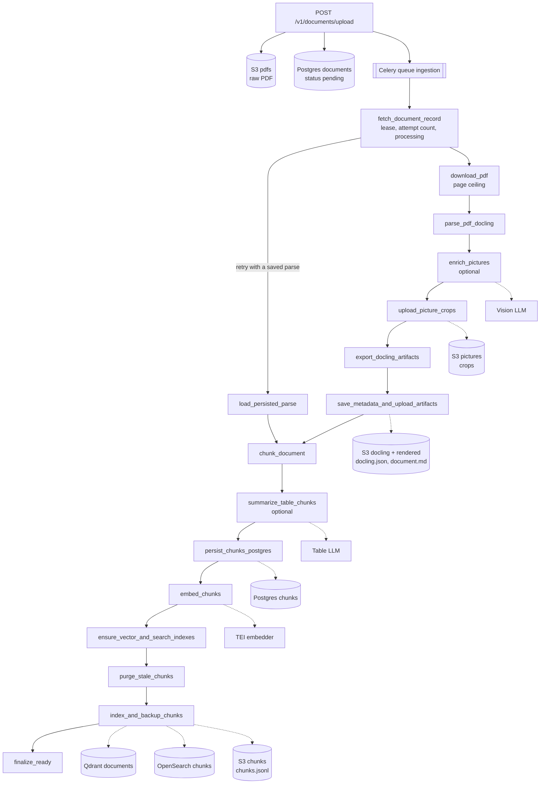
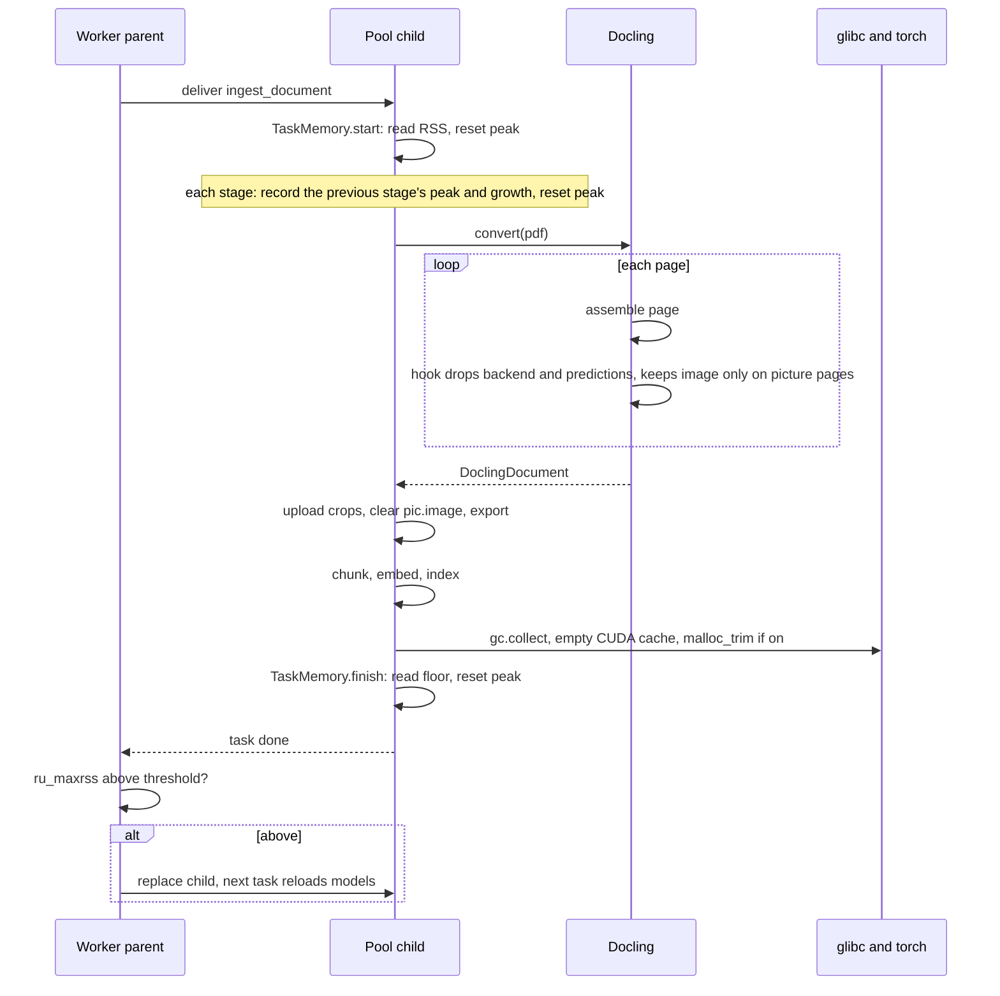
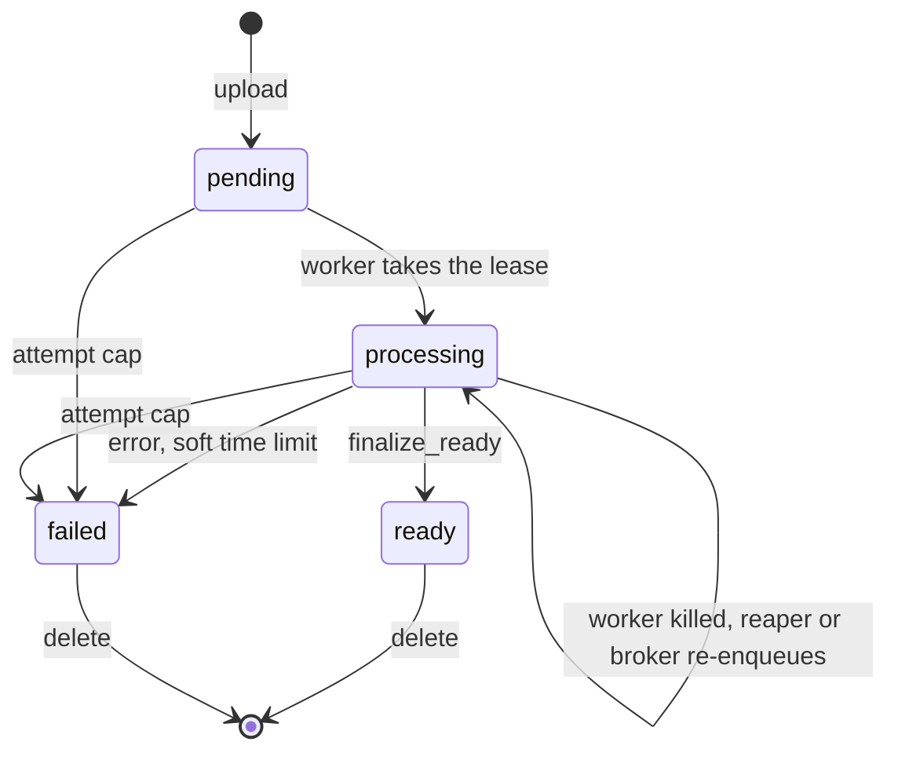

# Ingestion

How an uploaded PDF becomes searchable: the stages it goes through, what each one writes and
where, how the worker keeps a 1,000-page filing inside a 12 GiB container, and what happens
when a worker dies halfway. The code lives in `src/services/ingestion/`, with the worker
entry point in `src/workers/ingestion_worker.py` and the memory readings in
`src/observability/process_memory.py`. If the code and this doc disagree, the code wins, so
fix the doc.

## Contents

1. [The short version](#1-the-short-version)
2. [Stages](#2-stages)
3. [Memory](#3-memory)
4. [Failure and recovery](#4-failure-and-recovery)
5. [Progress events](#5-progress-events)
6. [Observability](#6-observability)
7. [Design decisions](#7-design-decisions)
8. [Failure modes](#8-failure-modes)
9. [Known limits](#9-known-limits)
10. [Quick reference](#10-quick-reference)

---

## 1. The short version

The API stores the PDF in S3 (Garage), creates a `documents` row at `pending` and enqueues one
Celery task, `ingest_document`, on the `ingestion` queue. A single worker process runs the
whole pipeline for that document in one task: parse with Docling, describe the pictures,
chunk, embed, and write the chunks to Postgres, Qdrant and OpenSearch. The row ends at
`ready` or `failed`.



Three things make this more than a loop over the stages:

| Problem | What handles it | Section |
|---|---|---|
| Stock Docling keeps every page in memory, so a ~1,000-page filing OOM-kills a 12 GB worker | A per-page release hook, cleanup after each task, a page ceiling and a memory-based worker recycle | [3](#3-memory) |
| A worker killed by the kernel runs no handler, so its row sits at `processing` | A Redis lease the task refreshes, and a reaper on read paths that re-enqueues rows with no lease | [4](#4-failure-and-recovery) |
| Some PDFs parse "successfully" into nothing or into glyph soup | A text-quality check and a scan check, each with an OCR re-parse, and a `parse_status` that never says `success` for a degraded parse | [2.5](#25-parse) |

Chunk text lives only in Postgres. Qdrant and OpenSearch store chunk IDs plus a few filter
fields, and retrieval turns the IDs back into text by reading Postgres.

---

## 2. Stages

`_run_pipeline` in `src/services/ingestion/tasks.py` runs the stages in this order. Each
stage name below is what the logs, the progress events and the `documents.ingest_time_seconds`
column use.

| # | Stage | Reads | Writes |
|---|---|---|---|
| 1 | `fetch_document_record` | `documents` row | Redis lease, attempt count, status `processing` |
| | `load_persisted_parse` (retries only) | S3 `docling.json` | |
| 2 | `download_pdf` | S3 raw PDF | temp file |
| 3 | `parse_pdf_docling` | temp file | in-memory `DoclingDocument` |
| | `enrich_pictures` (optional) | picture crops | `pic.meta.description` on the document |
| 4 | `upload_picture_crops` | picture crops | S3 `pictures` bucket |
| 5 | `export_docling_artifacts` | document | `docling.json`, `document.md` on disk |
| 6 | `save_metadata_and_upload_artifacts` | | `documents` metadata and `parse_status`, S3 `docling` and `rendered` buckets |
| 7 | `chunk_document` | document | chunk dicts in memory |
| | `summarize_table_chunks` (optional) | table chunks | `table_nl_summary` on each |
| 8 | `persist_chunks_postgres` | | `chunks` rows |
| 9 | `embed_chunks` | chunk text | vectors in memory |
| 10 | `ensure_vector_and_search_indexes` | | Qdrant collection, OpenSearch index |
| 11 | `purge_stale_chunks` (retries only) | | deletes this document's points and docs |
| 12 | `index_and_backup_chunks` | | Qdrant points, OpenSearch docs, S3 `chunks.jsonl` |
| 13 | `finalize_ready` | | status `ready`, stage timings |

The progress counter is 13 stages, plus one each for the two optional ones. A retry that
loads a saved parse skips download, parse, enrichment, crops, export and save.

S3 keys, all under the document's user and ID:

| Bucket (setting) | Key | Contents |
|---|---|---|
| `pdfs` (`S3_RAW_BUCKET`) | `raw/{user_id}/{document_id}/{filename}` | The uploaded PDF |
| `docling` (`S3_DOCLING_BUCKET`) | `processed/{user_id}/{document_id}/docling.json` | The parsed document, picture descriptions included, no images |
| `rendered` (`S3_RENDERED_BUCKET`) | `processed/{user_id}/{document_id}/document.md` | Markdown export |
| `chunks` (`S3_CHUNKS_BUCKET`) | `processed/{user_id}/{document_id}/chunks.jsonl` | One line per chunk, with its Postgres ID |
| `pictures` (`S3_PICTURES_BUCKET`) | `{document_id}/pictures/{n}.png` | One crop per picture, classification label and confidence as object metadata |

### 2.1 Upload

`upload_document` in `src/api/routers/documents.py` accepts `application/pdf` up to 100 MB
(`MAX_FILE_SIZE`), plus optional `company`, `year` and `type` form fields that become the
document's metadata. It creates the row first and uploads to S3 second. The storage key is
deterministic, so a failed upload deletes the row and leaves nothing orphaned in S3. Then it
enqueues `ingest_document` and returns at once.

The upload reads the request body in a thread. Starlette spools large uploads to disk, and a
blocking read on the event loop froze every open SSE stream for the length of the upload.

### 2.2 Claim the document

The first stage decides whether this delivery should run at all, in this order:

1. **Row is already `ready`.** Return. This is a stale redelivery of a document that has since
   finished, and running it would trip the attempt cap and mark a healthy document `failed`.
2. **Take the lease.** `SET NX` on `ingest:lease:{document_id}` with a 45 s TTL. If another
   worker holds it, return without counting an attempt. See [4.3](#43-the-lease-and-the-reaper).
3. **Clear the reap marker**, so the reaper may re-enqueue this document again later.
4. **Count the attempt.** If it's above `INGEST_MAX_ATTEMPTS` (3), mark `failed` and return.
5. **Set `processing`** and clear any earlier error.

The lease comes before the status change on purpose. A `processing` row with no lease then
always means its worker is gone, never that a worker hasn't claimed it yet.

### 2.3 Resume from a persisted parse

On attempt 2 or later, if the row already has a `parse_status`, the task downloads
`docling.json` and goes straight to chunking. `parse_status` is written in the same step that
uploads `docling.json`, and that JSON already carries the picture descriptions, so nothing
from the parse path is lost. If the file is missing or won't load, the task parses again.

This matters because parsing is the slow, memory-heavy part. A worker killed during
embedding or indexing doesn't pay for a second parse.

### 2.4 Download and the page ceiling

The PDF streams from S3 to a temp file in 256 KB pieces. Before any model runs,
`_enforce_page_limit` reads the page count with pypdfium2, which takes milliseconds, and fails
the document if it's above `INGEST_MAX_PAGES` (1,200). An unreadable page count is let through,
and the parse decides.

The check exists because the expensive failure isn't a slow parse. A document past the memory
ceiling OOM-kills the container, the broker redelivers it, and every attempt is spent on
container restarts with no record of why. The ceiling turns that into a clean `failed` with a
message. It's sized together with the memory recycle, see [3](#3-memory).

### 2.5 Parse

`docling_parser.parse` runs in a thread under `asyncio.wait_for` with a wall-clock limit of
`DOCLING_PARSE_TIMEOUT_SECONDS` (1,800 s). Python can't kill a thread, so a parse that times
out keeps running until it finishes or Celery's hard limit replaces the process. The document
fails right away either way.

**Converter settings (the lean parse).** One `DocumentConverter`, built once per worker
process, with `PictureAwarePdfPipeline` instead of Docling's stock PDF pipeline:

| Setting | Value | Why |
|---|---|---|
| `DOCLING_DO_OCR` | false | Born-digital filings have a text layer. OCR runs only as a fallback, below |
| `DOCLING_DO_TABLE_STRUCTURE` | true | Tables are where most of the numbers are |
| `DOCLING_DO_PICTURE_CLASSIFICATION` | true | The label routes each picture to a lane in enrichment |
| `DOCLING_GENERATE_PICTURE_IMAGES` | true | Crops for enrichment and for S3. `PictureAwarePdfPipeline` refuses to start without it |
| `DOCLING_GENERATE_PAGE_IMAGES` | false | Nothing reads full-page images |
| `DOCLING_DO_PICTURE_DESCRIPTION` | false | The inline SmolVLM captioner is replaced by the picture enricher |
| `DOCLING_IMAGES_SCALE` | 1.5 | Crop resolution |
| `DOCLING_DEVICE` | `cuda` | Layout and table models run on the GPU |

**Truncated parses fail.** `DOCLING_DOCUMENT_TIMEOUT` (1,200 s) bounds Docling's page loop.
When it fires, Docling stops, reports `PARTIAL_SUCCESS`, and the unparsed pages are simply
missing. That status looks the same as a run where a few pages failed on their own.
`_check_status` tells them apart by the failure category: pages abandoned to the timeout are
tagged `TIMEOUT`. If any are, it raises `TruncatedParseError` and the document fails. Indexing
it would answer questions from part of a filing with nothing to say so. A genuine partial
success, where every page was attempted, logs a warning and carries on. The parse runs at
about 0.45 s a page, so the page-loop limit leaves 2.5x headroom at the page ceiling.

**Scans.** With OCR off, Docling parses a scanned PDF to an almost empty document and still
reports success. Without a check, the document would end `ready` with zero chunks. The check
in `docling_parser.parse` has three steps.

1. **Is the parse suspiciously empty?** `text_quality.looks_textless` averages the parsed
   text over the page count. At 50 characters a page or more, the document is normal and the
   check stops. This keeps the probe off ordinary documents.

2. **Classify each page.** A scanned page and a blank page both parse to nothing, so
   `text_quality.classify_page_content` reads the PDF's own page objects with pypdfium2
   instead of the parsed document:

   ```text
   if   text-drawing operators > 5         -> text
   elif images cover >= 50% of the page    -> scanned
   else                                    -> blank
   ```

   The operator count goes first because image coverage alone misleads. One filing's cover
   page was entirely covered by a background image and still drew 18 text operators.

3. **Classify the document.** Blank pages don't vote.

   ```text
   if   no text pages and no scanned pages                -> blank
   elif scanned / (text + scanned) >= 50%                 -> scanned
   else                                                   -> text
   ```

   The bar is 50%, not 100%, so a few text pages don't stop a mostly scanned document from
   being OCR'd. If pypdfium2 can't read the PDF, the verdict is `text` and nothing changes,
   because the parse already succeeded.

What each verdict does:

| Verdict | Action | `parse_status` |
| --- | --- | --- |
| `text` | Nothing. Goes on to the garbled-text check below. | unchanged |
| `scanned`, OCR allowed | Second conversion with forced full-page OCR. Page-loop limit `DOCLING_OCR_DOCUMENT_TIMEOUT` (1,800 s), since OCR runs at about 4.3 s a page. | `success_scan_ocr`; `partial_success_scan_ocr` if the OCR parse was partial; `scanned_no_text` if the OCR'd text still averages under 50 characters a page |
| `scanned`, OCR not allowed (`DOCLING_SCAN_OCR_ENABLED=false`, or more pages than `DOCLING_OCR_MAX_PAGES`) | No OCR. | `scanned_no_text` |
| `blank` | No OCR. It would spend 4.3 s a page to confirm the document is empty. | `empty` |

**Garbled text.** If a PDF's fonts have a missing or wrong ToUnicode map, its text layer
holds glyph codes instead of letters. Docling reports success anyway. The parsed text takes
one of two shapes, often both in the same document:

- **Shifted letters.** `ILQDQFLDO` where the page shows "financial". It looks like words, but
  none of them are real.
- **Unmapped glyphs.** `GLYPH<c=3,font=/...>` for each character. That's about 40 characters
  of boilerplate per real one, so it is also a token bomb: one 120-page filing produced 4,034
  chunks instead of about 250.

The check runs only when the parse status is `success` or `partial_success` (so not after the
scan handling above) and `DOCLING_OCR_FALLBACK_ENABLED` is on (default `true`). With the flag
off, nothing is checked and garbled text is indexed as `success`.

1. **Take a sample.** `text_quality.sample_document_text` joins the parsed text items in
   document order until it has 50,000 characters. The sample is the start of the document,
   not a random spread.

2. **Score it.** `text_quality.assess`:

   ```text
   if   more than 1 GLYPH marker per 1,000 characters   -> garbled
   elif sample shorter than 2,000 characters            -> not garbled
   elif stopword ratio < 0.02                           -> garbled
   else                                                 -> not garbled
   ```

   - The marker test catches unmapped glyphs directly. It goes first because markers prove
     the text is broken however short the sample is.
   - The stopword ratio catches shifted letters. It is the share of words in the sample that
     are one of ten English function words: the, and, of, to, in, for, is, that, with, as.
     Shifted letters mangle every one of them, so the ratio drops to near zero. Real prose
     measures 0.06 and up, and a broken-font PDF measured 0.0003. The 0.02 cutoff is
     `DOCLING_TEXT_QUALITY_THRESHOLD`.
   - Under 2,000 characters there is too little prose for the ratio to mean anything. This
     mostly protects table-heavy documents.

What each result does:

| Result | Action | `parse_status` |
| --- | --- | --- |
| Not garbled | Nothing. | unchanged |
| Garbled, at most `DOCLING_OCR_MAX_PAGES` pages | Second conversion with forced full-page OCR, then the same check on the new text. | `success_ocr_fallback`; `partial_success_ocr_fallback` if the OCR parse was partial; `garbled_text` if the new text still fails |
| Garbled, more pages than `DOCLING_OCR_MAX_PAGES` | No OCR. | `garbled_text` |

A garbled document is still indexed in every case. The status is there so it never passes
as `success`.

Both OCR paths are skipped above `DOCLING_OCR_MAX_PAGES` (300). A re-conversion on a large
document is the slowest and heaviest thing the pipeline can do, and it runs inside the same
parse budget.

Before the second conversion the first result is dropped and garbage-collected, so the two
don't sit in memory together. The OCR converter is a second full pipeline with its own
models, and it's released after the parse that needed it.

The UI shows a warning badge for any `parse_status` other than `success`.

### 2.6 Picture enrichment

Off by default in code and `.env.example`, on in the Kubernetes config
(`PICTURE_ENRICHER_ENABLED`). `picture_enricher.enrich_pictures` sends picture crops to a
vision model and writes the answer to `pic.meta.description`. The chunker later puts that
text where the picture's `<!-- image -->` placeholder was. Without enrichment the placeholder
is dropped, and charts contribute nothing to search.

Each picture is routed by its Docling classification label:

| Lane | Labels | Model | Image detail |
|---|---|---|---|
| Chart | `bar_chart`, `line_chart`, `pie_chart`, `flow_chart`, `other`, any label under `PICTURE_ENRICHER_MIN_CONFIDENCE` (0.5) | `PICTURE_ENRICHER_MODEL` (`gpt-5-mini`) | high |
| Caption | every other label | `PICTURE_ENRICHER_CHEAP_MODEL` (`gpt-4o-mini`) | low |
| Skip | `logo`, `icon`, `signature`, `stamp`, `qr_code`, `bar_code` | none | |

`other` goes to the chart lane because the KPI tiles and infographic panels in annual reports
land there, and they're as dense with numbers as a chart. A low-confidence label is treated as
`other`. A misread chart in the caption lane would lose its numbers, and a misread logo in the
chart lane would cost a paid call.

Calls carry three pictures each (`PICTURE_ENRICHER_BATCH_SIZE`) with structured output, and up
to four run at once across both lanes (`PICTURE_ENRICHER_CONCURRENCY`). The limit is shared
because the provider's rate limit is per account. An empty or unparseable response gets one
retry. The completion budget is `max(4000, 1200 × pictures)` tokens, since on reasoning models
reasoning tokens count against it and a small budget returned empty bodies.

The stage budget is `max(300 s, 1 s × pictures)`, capped so at least 300 s of the task's soft
limit is left for the stages after it. Measured throughput is about 0.7 s a picture. When the
budget runs out, finished batches keep their descriptions and the rest go without.

Enrichment never fails a document. A failed batch leaves its pictures undescribed, and the
chunker drops their placeholders. A misconfigured model, one not marked `vision` in
`models.yaml`, fails at worker start instead, so it can't silently degrade every document.

### 2.7 Picture crops and artifacts

The parse attaches an image (a crop) to every picture it finds, as `pic.image`. That image
stays in memory until export, and a PNG copy of it stays in S3 until the document is deleted:

| After stage | `pic.image` in memory | PNG in the `pictures` bucket |
| --- | --- | --- |
| `parse_pdf_docling` | yes | no |
| `enrich_pictures` | yes, read but not changed | no |
| `upload_picture_crops` | yes | yes |
| `export_docling_artifacts` | no, cleared | yes |
| document deleted | n/a | no, removed by the purge (section 4.5) |

**`upload_picture_crops`** saves a PNG of every picture to S3. For each picture that has an
image:

1. Encode the image to PNG in a worker thread, and read its classification label and
   confidence if Docling produced one.
2. Upload the PNG to `{document_id}/pictures/{n}.png`, with the label and confidence as S3
   object metadata.
3. Discard the PNG bytes once the upload returns. `pic.image` itself is untouched.

At most eight pictures are in steps 1 and 2 at once, so a 300-picture document holds at most
eight PNGs in memory and has at most eight requests open to Garage. A picture that fails to
encode or upload is logged (`pipeline.picture_crop_encode_failed`,
`pipeline.picture_crop_upload_failed`) and skipped. The document carries on.

The stage runs whether enrichment is on or off, and it uploads every picture, including the
logos and signatures the enricher skips. Nothing in the app reads the bucket back: the only
other code that touches it is the delete purge. The label metadata was added for a picture
router that hasn't been built.

**`export_docling_artifacts`** sets `pic.image = None` on every picture, then writes
`docling.json` and `document.md` to the task's temp directory. It has to come after the
upload, because the upload is the last stage that needs the images. Clearing them does two
things:

- Docling's JSON export embeds each image as base64 even with image placeholders on.
  Without the clear, `docling.json` would hold a second copy of the bucket at 1.33x its size.
- The images' memory is freed before chunking.

The picture descriptions live in `pic.meta`, not `pic.image`, so `docling.json` keeps them.
`document.md` shows each picture as an `<!-- image -->` placeholder.

**`save_metadata_and_upload_artifacts`** does three things in parallel:

- writes `page_count`, `extracted_title` (the first title item), `parse_status` and the
  merged metadata to the `documents` row
- uploads `docling.json` to the `docling` bucket
- uploads `document.md` to the `rendered` bucket

It then deletes both local files.

**On a retry.** If the retry resumes from the saved `docling.json`, its pictures have no
images, so none of these three stages runs and the earlier attempt's PNGs stay in S3. If it
parses again, the upload writes to the same keys and overwrites them.

### 2.8 Chunking

`chunker.chunk_document` uses `CustomHybridChunker`, a subclass of Docling's `HybridChunker`
with a BGE-M3 tokenizer:

| Setting | Value | Effect |
|---|---|---|
| `CHUNKING_MAX_TOKENS` | 900 | Docling splits items larger than this |
| `CHUNKING_MIN_TOKENS` | 100 | Chunks smaller than this get merged with neighbours |
| `CHUNKING_MAX_MERGE_MULTIPLIER` | 3.0 | A merge stops at `min(900, 100 × 3) = 300` tokens |

Three changes on top of the stock chunker:

- **Header runs are nested.** Docling gives every section header in a PDF level 1, and the
  chunker keeps one heading per level. A statement title split over three lines ("Company,
  Inc." / "Consolidated Statements of Operations" / "(in millions)") reached the chunk as its
  last line only. `_nest_header_runs` levels each back-to-back header one below the previous,
  within a page, then restores the levels after chunking.
- **Small chunks merge harder.** Runs of undersized chunks merge up to the limit above, and a
  leftover small chunk merges into the next or previous one if it fits.
- **Tables serialize as Markdown tables**, and picture placeholders are replaced with
  descriptions in order.

Each chunk gets two texts. `raw_text` is the content. `enriched_text` puts the heading trail
in front as `[SECTION] ...` lines, which is what gets embedded and indexed. Each chunk also
gets `chunk_type` (`table` if it contains a table, `picture` if it holds only pictures,
otherwise `text`), its page span, and provenance (bounding boxes and `doc_item_refs` into
`docling.json`).

A document that produces no chunks finishes as `ready` with zero chunks and counts as
`no_content` in `ingestion_documents_total`, not `success`.

### 2.9 Table summaries

Off by default and in every shipped config (`TABLE_SUMMARIZER_ENABLED`). When on,
`table_summarizer.summarize_table_chunks` asks `TABLE_SUMMARIZER_MODEL` (`qwen3-8b` on vLLM)
for a plain-language summary of each table chunk, three tables a call, four calls at once. The
summary replaces the table text as the input to embedding. OpenSearch still indexes
`enriched_text`. A failed batch leaves its summaries empty and those tables embed their own
text.

### 2.10 Persist, embed, index

**Postgres.** `ChunkRepository.create_many` deletes the document's existing chunks and inserts
the new ones in one transaction, so a retry never leaves duplicates. It first checks the
document still exists.

**Embedding.** `embedder.embed_chunks` posts batches of 64 to TEI (`BAAI/bge-m3`, normalized),
four requests in flight. The batch size is clamped to what TEI's `/info` reports as its
maximum, so a mismatched config corrects itself. Vectors are kept as float32 arrays. A vector
of the wrong dimension (`EMBEDDING_DIM`) fails the document.

**Indexes.** The Qdrant collection `documents` (cosine, one shard, payload indexes on
`user_id` and `document_id`) and the OpenSearch index `chunks` (one shard, no replicas) are
created if missing.

**Purge.** On attempt 2 or later, the task deletes everything indexed under this document ID
before writing. It's keyed by document ID, not by a list of chunk IDs, so it works wherever
the previous attempt died.

**Write.** Three writes run in parallel:

- Qdrant points, ID = chunk ID, payload `chunk_id`, `document_id`, `user_id`, `chunk_index`,
  `chunk_type`, pages and heading trail. Batches of 500. Only the last batch waits for the
  write, which is safe because Qdrant applies writes in order per shard and the collection has
  one.
- OpenSearch documents, `_id` = chunk ID, with `enriched_text` as the searchable field. One
  index refresh at the end.
- `chunks.jsonl` to S3, written to disk a line at a time, then uploaded.

### 2.11 Finalize

The row goes to `ready`, and `ingest_time_seconds` records each stage's duration in order plus
the total. On failure the same column records the stages that ran and `failed_at_stage`.

---

## 3. Memory

The ingestion worker is one pod with one Celery child process and a 12 GiB memory limit, and
it parses one document at a time. One slot is set by GPU memory: each child holds a full
Docling model stack.

### 3.1 The failure

With picture crops and classification on, stock Docling never frees a page. It releases a
page's images only when `keep_images` is off, and its backend only when `keep_backend` is
off. `generate_picture_images` turns on the first, `do_picture_classification` the second.
Docling has no narrower option, because it crops pictures at the very end of the run and
can't know earlier which pages it'll need. Peak memory grew 13.1 MB a page, and a
~1,000-page filing OOM-killed a 12 GB worker.

A second problem only showed up across documents. glibc kept memory the parse had freed on
its per-thread heaps, so the child's floor rose about 545 MB per document and never came
back. Peak memory followed queue position, not document size: the same small document peaked
at 5.6 GB or 10.3 GB depending on how many documents ran before it. A 12 GiB worker ran out
after about 18 documents of any size.

### 3.2 The fixes

| Fix | Where | What it bought |
|---|---|---|
| Per-page release hook | `docling_pipeline.PictureAwarePdfPipeline._release_page_resources` | 1,043-page filing: 15.7 GB peak to 7.3 GB. 4.9 MB a page instead of 13.1. No wall-clock cost |
| Release the first conversion before an OCR re-parse, and the OCR converter after | `docling_parser.parse`, `release_ocr_converter` | One converter's pages in memory at a time, not two |
| Crops uploaded eight at a time, then cleared before export | `tasks._upload_picture_crops`, `_export_artifacts` | No list of every encoded crop, no base64 copy in `docling.json` |
| Streamed artifacts | `_write_chunks_jsonl`, `s3_client.upload_file`, `download_file` | Files go to and from disk, never whole in memory |
| `gc.collect` and `malloc_trim` after each task | `tasks._record_task_end`, `INGEST_MALLOC_TRIM` | Floor growth from +545 MB to +29 MB a document. Largest document's peak 13.1 GB to 6.5 GB |
| Empty torch's CUDA cache after each task | `docling_parser.empty_cuda_cache`, `INGEST_CUDA_EMPTY_CACHE` | Worker VRAM at rest 2,126 MiB to 676 MiB |
| Recycle the child by memory | `--max-memory-per-child`, `INGEST_WORKER_MAX_MEMORY_PER_CHILD_KB` | Bounds the floor no matter what leaks |
| Page ceiling | `INGEST_MAX_PAGES` | Bounds a single document's demand |

**The hook.** `PictureAwarePdfPipeline` runs after each page is assembled, when it's known
which elements are on the page. It always drops the page's predictions and backend, since
nothing reads them after assembly. It keeps the page image only if the page holds a picture,
and then only at the crop scale. It reads Docling's private attributes, which is why Docling
is pinned to 2.111.0 and why its tests use real Docling objects: a version that moves those
attributes should fail a test, not quietly bring back the 13.1 MB/page slope.

**The cleanup.** After the task returns, `_record_task_end` runs `gc.collect()`, empties the
CUDA cache, then runs `malloc_trim(0)`. The CUDA release goes first because it frees host-side
bookkeeping the trim can then return. The trim is off by default in code and `.env.example`
and on in Kubernetes. It's a trade: it took 0.44 s per document in measurement and walks every
heap, and it returns memory glibc might have reused. Without it the floor climbs until the
recycle replaces the child, which means reloading the Docling models every few documents. The
CUDA release is on everywhere, because getting a released block back costs milliseconds
against a parse measured in minutes.

**The recycle.** Celery's `--max-memory-per-child` compares the child's peak RSS
(`ru_maxrss`) with the threshold after each task and replaces the child if it's over. Left
alone, that compares the task's peak, and every large document would cost a model reload even
if it gave all its memory back. `TaskMemory.finish()` writes `5` to `/proc/self/clear_refs`
at task end, which resets the peak to current RSS. The recycle then compares what the child
kept, which is what the next document starts on. This is why the cleanup has to run before
`finish()`: trimming after it would recycle on memory already returned.

The recycle is set on the ingestion worker's command line, not in `celery_app.conf`, because
the chat worker shares that config.

### 3.3 Sizing

Three numbers depend on each other: the recycle threshold T, the page ceiling, and the
container limit. A fresh child needs about 2.44 GB plus 4.9 MB a page. Measured on a warm
child, 1,043 pages needed 5.13 GB above its starting floor. The budget:

```
T + parent + demand(1200 pages)   + margin  ≤ limit
5.0 + 0.48 + 5.13/1043 × 1200     + 1.0     = 12.38 GB ≤ 12.88 GB (12 GiB)
```

`test_default_budget_fits_the_limit` checks this, so raising the page ceiling or T without the
limit fails CI. On Kubernetes a 20-document backlog ran with zero recycles and zero restarts.
The largest document there peaked at 9.2 GB, and its demand above the inherited floor came
within 0.2% of the prediction.

### 3.4 One task's memory



---

## 4. Failure and recovery

### 4.1 Time limits

Every limit sits inside the next one, so the innermost cause is the one reported:

| Limit | Default | Bounds | On expiry |
|---|---|---|---|
| `DOCLING_DOCUMENT_TIMEOUT` | 1,200 s | Docling's page loop | `TruncatedParseError`, document `failed` |
| `DOCLING_PARSE_TIMEOUT_SECONDS` | 1,800 s | The whole parse, OCR re-parse included | Document `failed` |
| Enrichment budget | `max(300, pictures × 1 s)`, capped | Picture enrichment | Keeps what finished, continues |
| `INGEST_TASK_SOFT_TIME_LIMIT_SECONDS` | 2,400 s | The task | `SoftTimeLimitExceeded`, `failed` with the stage name |
| `INGEST_TASK_TIME_LIMIT_SECONDS` | 2,700 s | The task | Celery kills the child. No handler runs, see 4.3 |
| `CELERY_VISIBILITY_TIMEOUT_SECONDS` | 3,600 s | An unacked task in the broker | Redelivery |

Ingestion has its own soft and hard limits on the task decorator. The app-wide pair (360 s
and 450 s) is sized for chat. Under it, Celery killed large parses before any inner timeout
could fire, and every large-document failure showed up as a generic `SoftTimeLimitExceeded`.
The visibility timeout is shared by both queues, so it has to clear ingestion's hard limit.

### 4.2 Attempts and redelivery

Celery runs with `task_acks_late` and `task_reject_on_worker_lost`. A task is acknowledged
when it finishes, and a task whose process dies is redelivered. A task that raises is
acknowledged and not retried, so `failed` is final and the user uploads again.

The attempt counter is `documents.ingest_attempt_count`, incremented once a delivery holds the
lease. `INGEST_MAX_ATTEMPTS` (3) caps it. The cap is what stops a document that kills its
worker every time from looping forever: each redelivery spends an attempt, and the fourth
marks it `failed`.

If the row isn't found at all, the task retries every second up to 10 times, then fails.

### 4.3 The lease and the reaper

A worker that's OOM-killed, evicted or loses its node runs no exception handler. Its row stays
at `processing`, and the broker won't redeliver for up to an hour. The lease makes that state
detectable in one Redis round trip.

**The lease.** `_DocumentLease` holds `ingest:lease:{document_id}` with a random token and a
45 s TTL (`INGEST_LEASE_TTL_SECONDS`). A heartbeat refreshes it every 15 s
(`INGEST_HEARTBEAT_INTERVAL_SECONDS`), so two missed refreshes are survivable. Docling parses
in a thread, which leaves the event loop free to run the heartbeat during the parse. Refresh
and release are compare-and-set Lua scripts on the token. If a refresh finds the key owned by
someone else, after a Redis restart for example, the heartbeat cancels the task, which
returns without writing anything and leaves the document to the new owner. If Redis is down
when the task starts, it runs without a lease. Refusing to ingest is the worse failure.

**The reaper.** `recovery.reap_abandoned` looks at `processing` rows, checks their leases in
one pipelined call, and re-enqueues any row with no lease. It runs on read paths, not on a
schedule, because there's no Celery beat deployment and someone looking at the document is
when recovery matters:

- `GET /v1/documents`, the document list
- the ingestion progress stream, after about a minute with no events
- the sample-corpus seeder

A new document waiting in the queue is still `pending`, so it's never a candidate. A
re-enqueued one is different: it sits at `processing` with no lease until a worker picks it
up, which looks exactly like an abandoned row. The reap marker
`ingest:reap:{document_id}` (`SET NX`, `INGEST_REAP_DEBOUNCE_SECONDS`, 3,600 s) stops every
read from queuing another copy. The task deletes the marker when it claims the document. Two
API replicas reaching the same row is harmless: both enqueue, one delivery wins the lease, and
the other returns without spending an attempt.

The hard time limit ends the same way. Celery kills the child, the row stays at `processing`,
the lease expires, and the next read re-enqueues it.

### 4.4 Re-running safely

A retry can start after any stage of a previous attempt, so every write is safe to repeat:

| Store | How a repeat is handled |
|---|---|
| `documents` row | Plain updates |
| `chunks` rows | `create_many` deletes the document's chunks before inserting |
| Qdrant, OpenSearch | Purged by document ID before indexing, on attempt 2 and later. IDs are chunk IDs |
| S3 | Fixed keys, overwritten |
| Parse | Skipped if `docling.json` was saved |

### 4.5 Delete

`DELETE /v1/documents/{id}` calls `purge.purge_document`. It deletes the document's Qdrant
points and OpenSearch docs first. If either fails, it stops with a 503 and touches nothing
else, so the delete can be retried. A failed index delete swallowed here would leave chunks
indexed with no Postgres row to hydrate them. Then it deletes the S3 objects (failures there
are logged, not fatal), the `chunks` rows and the `documents` row.

### 4.6 Document status



`ready` with zero chunks is possible, for an `empty` or `scanned_no_text` document. The
`parse_status` column says which.

---

## 5. Progress events

The task writes events to a Redis stream, `ingestion:events:{document_id}`, capped at 100
entries and given a TTL (`INGEST_EVENTS_TTL`, 3,600 s) on every write. A killed task writes no
final event, so the TTL is the only thing that cleans its stream up. Writing an event never
fails the task.

| Event | Producer | Payload |
|---|---|---|
| `stage` | task, at each stage | `stage`, `stage_index`, `stage_total` |
| `done` | task | `chunks` |
| `error` | task | `message`: the soft-limit message with the stage, or "Document processing failed. Please try again." |
| `retrying` | API, after a reap | `attempt` |
| `done` / `error` | API, when the row is already terminal | the row's `processing_error` for `error` |

`GET /v1/documents/{id}/stream` serves it as SSE. It reads with 15 s blocking reads and sends a
keepalive on each empty one. After four empty reads it checks the row: a terminal status ends
the stream, a reap sends `retrying` and keeps the stream open for the new attempt. If the
lease can't be read either, it gives up after `INGEST_STREAM_ABANDONED_AFTER_SECONDS` (2,760 s,
the hard limit plus a margin) with no progress. A Redis read error ends the stream without an
`error` event, since it says nothing about the ingestion itself.

In the UI, `subscribeIngestionStream` (`src/ui/services/api.ts`) reconnects with backoff from
1 s to 30 s when the connection drops, and re-reads the document list meanwhile. A dropped
connection never marks a document as failed. Only an `error` event does. `App.tsx` maps stage
names to short labels (`INGEST_STAGE_LABELS`) and shows them in the document list as
"Parsing 3/15".

---

## 6. Observability

**Metrics** (`src/observability/metrics.py`), scraped from the worker on port 9101:

| Metric | What it shows |
|---|---|
| `ingestion_documents_total{status}` | `success`, `failed`, `no_content` |
| `ingestion_documents_reaped_total{source}` | Re-enqueues after a dead worker, by `list`, `stream`, `sample_seed` |
| `ingestion_stage_duration_seconds{stage}` | `parse`, `chunk`, `embed`, `upsert_qdrant`, `upsert_opensearch` |
| `ingestion_queue_wait_seconds` | Upload to task start, first attempt only |
| `ingestion_chunks_per_document` | Chunk count |
| `picture_enricher_pictures_total{lane,status}` | `described`, `skipped`, `failed`, `empty`. `empty` means a starved completion budget |
| `picture_enricher_batch_seconds{lane}` | Per-call latency |
| `ingestion_worker_rss_bytes{point}` | RSS at `task_start` and `task_end` |
| `ingestion_worker_peak_rss_bytes{stage}`, `ingestion_worker_stage_growth_bytes{stage}` | Peak and growth per stage, last document |
| `ingestion_worker_malloc_free_bytes` | Free space on glibc's lists. Not residency: a trim returns pages without changing it |
| `ingestion_worker_recycle_threshold_bytes`, `ingestion_worker_recycles_total`, `ingestion_worker_child_tasks` | The recycle |

The Grafana dashboard is "Worker Health" (`worker-health.json`).

**Logs.** `pipeline.stage` at each stage, `pipeline.complete` or `pipeline.failed_at_stage`
with stage timings, and one `pipeline.memory` line per task with the floor, per-stage peaks
and growth, and whether a recycle is expected.

**Traces.** One Langfuse trace per document, with the enrichment and table-summary LLM calls
nested under it.

**Alerts.** Defined only in the Kubernetes chart
(`infra/k8s/chart/files/observability/alert-rules.yml`). Compose loads no rules.

| Alert | Fires when |
|---|---|
| `IngestionWorkerStartedAboveThreshold` | A document started on more memory than the recycle threshold, so the recycle isn't working |
| `IngestionWorkerRecyclingOften` | More than 10 recycles an hour, so small documents are leaving memory behind too |
| `IngestionDocumentsReaped` | Any reap in 15 minutes: a worker died mid-document |
| `IngestionRecoveryNotConverging` | More than 5 reaps an hour: replacement attempts are dying the same way |
| `ContainerOOMKilled` | Any container, this one included |

---

## 7. Design decisions

**One task per document.** The whole pipeline runs in one task in one process, and the parsed
document stays in memory between stages. Saving `docling.json` gives retries the benefit a
task chain would have had, skipping the expensive parse, without passing a large document
between tasks.

**Fail rather than index part of a document.** A truncated parse fails. An answer drawn from
two thirds of a filing, with nothing saying so, is worse than an upload the user has to retry.

**Never call a degraded parse `success`.** OCR-derived, garbled, scanned and partial parses
each get their own `parse_status`, and the UI badges all of them. A document with no chunks
counts as `no_content`, not `success`.

**Enrichment degrades, never fails.** Pictures are optional evidence. A provider outage leaves
pictures undescribed and the document searchable. Bad configuration is the exception: it fails
the worker at start.

**Liveness from a lease, recovery on read.** The broker's redelivery is correct but slow,
since the visibility timeout has to outlast the longest legitimate parse. The lease answers
"is anyone working on this" in one round trip, and running the check where documents are read
needs no scheduler.

**Purge by document ID, before indexing.** An earlier version purged by a list of old chunk IDs
read from Postgres, after indexing. A rollback erased that list, and with it the record of what
needed cleaning.

**Text only in Postgres.** Qdrant and OpenSearch hold IDs and filter fields. One store holds
the text, so the indexes can never disagree with it about what a chunk says.

**Recycle on memory, not task count.** A task count doesn't bound the floor. What a child
keeps depends on the largest document it has parsed, so the recycle reads memory, after the
peak reset.

**Pin Docling and test its internals.** The release hook depends on private attributes. Pinning
plus tests with real Docling objects makes an upgrade fail loudly instead of bringing back the
OOM.

---

## 8. Failure modes

| What goes wrong | What the pipeline does | What the user sees |
|---|---|---|
| PDF over 1,200 pages | Fails before parsing | `failed`, message names `INGEST_MAX_PAGES` |
| Page loop hits its timeout | `TruncatedParseError` | `failed` |
| Parse passes 1,800 s | Fails, parse thread runs on | `failed` |
| Scanned PDF | OCR re-parse up to 300 pages | `ready`, badge. `scanned_no_text` with zero chunks if OCR found nothing or the document was too large |
| Broken font encoding | OCR re-parse up to 300 pages | `ready`, badge |
| Blank PDF | No OCR | `ready`, zero chunks, `empty` |
| Vision model down or slow | Pictures undescribed, placeholders dropped | `ready`, charts not searchable |
| Table LLM down | Tables embed their own text | `ready` |
| TEI, Qdrant, OpenSearch or Postgres error | Task raises | `failed` |
| Soft time limit | Fails with the stage name | `failed` |
| Worker OOM-killed or evicted | Lease expires, next read re-enqueues, parse reused if saved | "Retrying (attempt n)", then stage events again |
| Same document kills every worker | Each re-enqueue spends an attempt | `failed` after 3 attempts. `IngestionRecoveryNotConverging` fires |
| Redis down at task start | Runs without a lease | Normal, but a crash then isn't detected until broker redelivery |
| Progress stream drops | Client reconnects | Nothing, the label keeps updating |
| Index delete fails on document delete | Nothing else deleted | 503, retry the delete |

---

## 9. Known limits

- **GPU required.** Docling's layout and table models, OCR and the TEI embedder all run on
  CUDA. Compose and the chart ship no CPU configuration.
- **One document at a time.** One pod with one child. A backlog waits in the queue, and queue
  wait is most of the user-visible latency for anything behind a large filing.
- **Docling is pinned to 2.111.0** because of the release hook. Upgrading means re-checking the
  private attributes `docling_pipeline.py` reads.
- **`failed` is final.** There's no re-ingest endpoint. The user deletes and uploads again.
- **Deleting a document during ingestion** *(inferred from the code, not tested)*. The task
  checks the row still exists before writing chunks, but not before indexing, so a delete that
  lands during embedding can leave points in Qdrant and OpenSearch with no Postgres row.
  Retrieval skips them when it finds no text for them, but they still take result slots and
  nothing removes them.
- **The `error` message differs by path.** The live stream sends a generic message, while a
  reconnect to a failed document sends the row's `processing_error`, which is the raw exception
  text.
- **Alerts only exist in Kubernetes**, and nothing routes them anywhere yet.

---

## 10. Quick reference

| Question | Where to look |
|---|---|
| Stage order and what each writes | `tasks.py::_run_pipeline` |
| Upload and enqueue | `src/api/routers/documents.py::upload_document` |
| Claiming a document, the attempt cap | `tasks.py::_run_pipeline` (first stage), `_DocumentLease` |
| Resume from a saved parse | `tasks.py::_load_persisted_document` |
| Page ceiling | `tasks.py::_enforce_page_limit`, `docling_parser.py::probe_page_count` |
| Converter settings | `docling_parser.py::_create_converter` |
| Truncated parse check | `docling_parser.py::_check_status` |
| Scan and garbled-text checks, OCR re-parse | `docling_parser.py::parse`, `text_quality.py` |
| Per-page release hook | `docling_pipeline.py::PictureAwarePdfPipeline` |
| Picture routing and calls | `picture_enricher.py::_plan`, `_run_lane`, `enrich_pictures` |
| Crop upload, artifact export | `tasks.py::_upload_picture_crops`, `_export_artifacts` |
| Chunking, header nesting, placeholders | `chunker.py::CustomHybridChunker`, `_nest_header_runs`, `chunk_document` |
| Table summaries | `table_summarizer.py::summarize_table_chunks` |
| Embedding | `embedder.py::embed_chunks`, `_embed_tei` |
| Qdrant and OpenSearch writes | `qdrant_ingest.py::upsert_chunks`, `opensearch_ingest.py::bulk_index` |
| Memory cleanup and readings | `tasks.py::_record_task_end`, `process_memory.py::TaskMemory` |
| Recycle flag | `ingestion_worker.py::build_worker_argv` |
| Time limits | `tasks.py` (task decorator), `src/celery_app.py` |
| Reaper | `recovery.py::reap_abandoned` |
| Delete | `purge.py::purge_document` |
| Progress stream | `src/redis_client.py::add_ingestion_event`, `documents.py::ingestion_stream` |
| UI side of progress | `src/ui/services/api.ts::subscribeIngestionStream`, `src/ui/App.tsx` |

### Tests

| Area | File |
|---|---|
| Release hook | `tests/unit/test_docling_pipeline_release.py` |
| Truncated and partial parses | `tests/unit/test_docling_parser_status.py` |
| Page ceiling, OCR page cap | `tests/unit/test_parse_guardrails.py` |
| OCR converter release | `tests/unit/test_docling_ocr_converter_release.py` |
| Garbled text and scan detection | `tests/unit/test_text_quality.py` |
| Picture enrichment | `tests/unit/test_picture_enricher.py` |
| Crops, export, chunk backup, shared S3 client | `tests/unit/test_ingestion_artifacts.py` |
| Chunk merging | `tests/unit/test_chunker.py`, `tests/integration/test_chunker_integration.py` |
| Qdrant upsert, table summaries, purge, resume | `tests/unit/test_ingestion_backlog.py` |
| Embedding | `tests/unit/test_embedder.py` |
| Index writes | `tests/unit/test_qdrant_ingest.py`, `tests/unit/test_opensearch_ingest.py` |
| Memory readings and cleanup | `tests/unit/test_process_memory.py`, `test_ingestion_task_memory.py`, `test_ingest_cuda_empty_cache.py` |
| Recycle flag and the memory budget | `tests/unit/test_ingestion_worker_argv.py` |
| Lease | `tests/unit/test_ingest_lease.py` |
| Reaper | `tests/unit/test_ingest_recovery.py` |
| Progress stream and its bounds | `tests/unit/test_ingestion_stream.py`, `test_ingestion_events_bounds.py` |
| Whole pipeline with mocked services | `tests/integration/test_ingestion_worker.py` |
